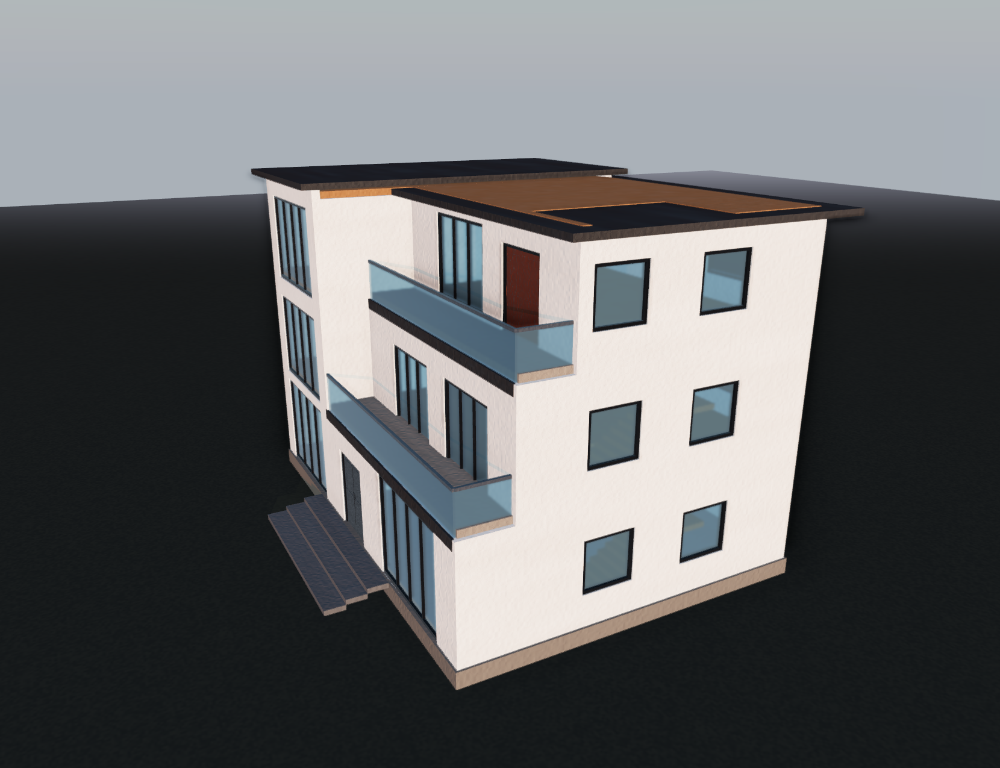
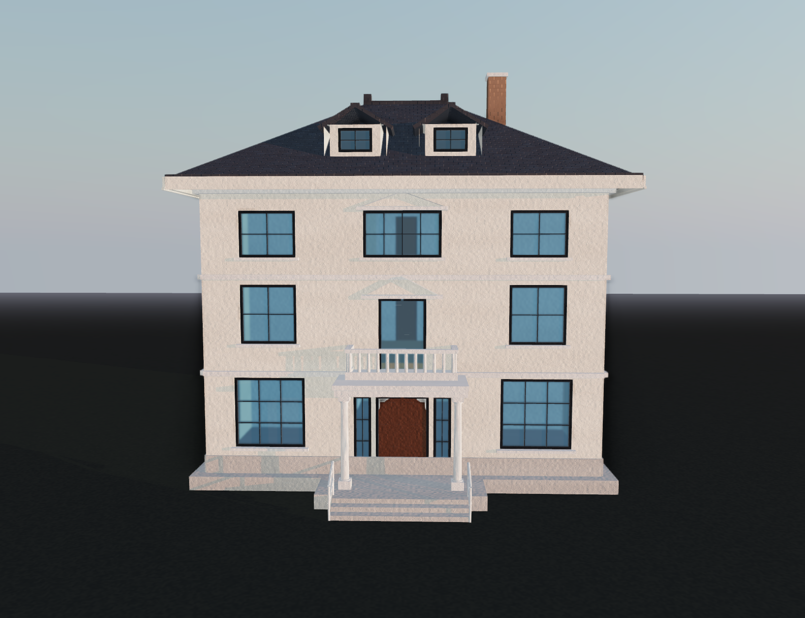
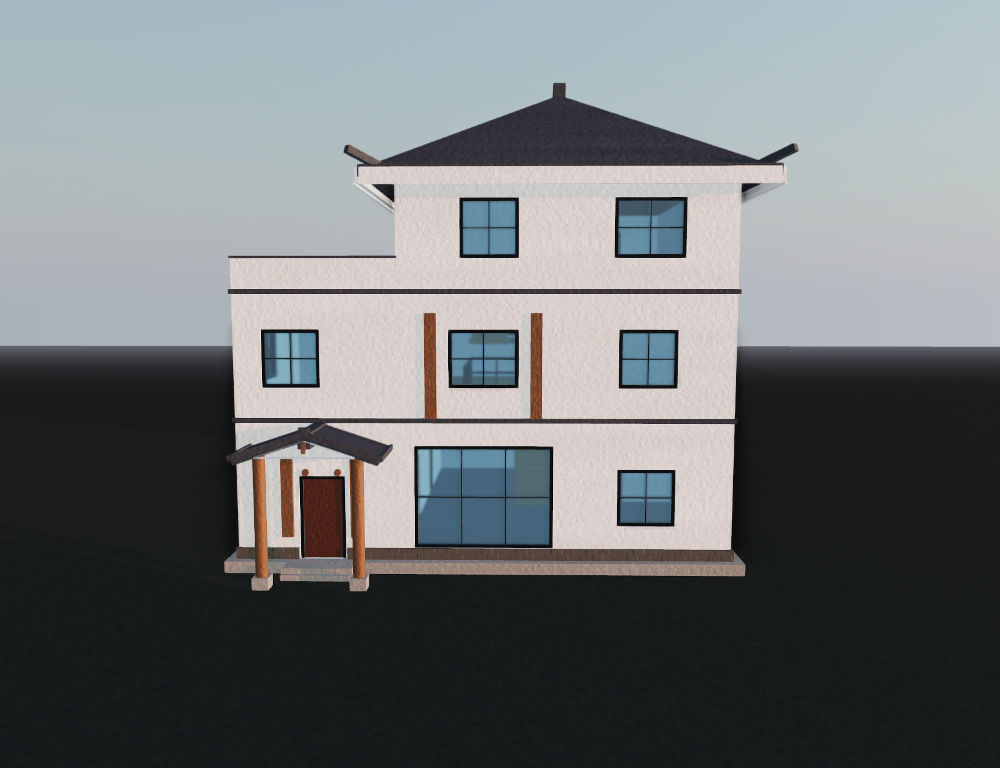
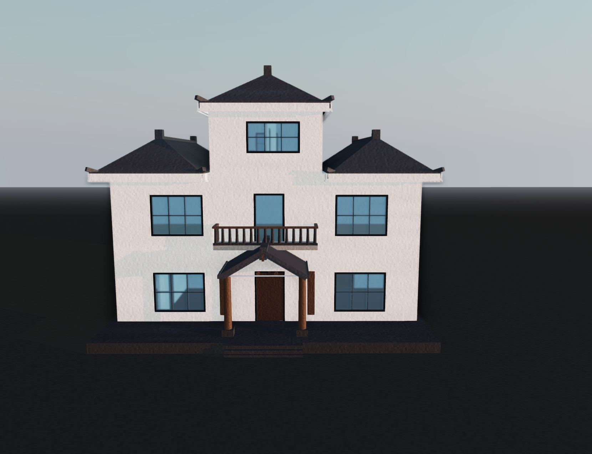
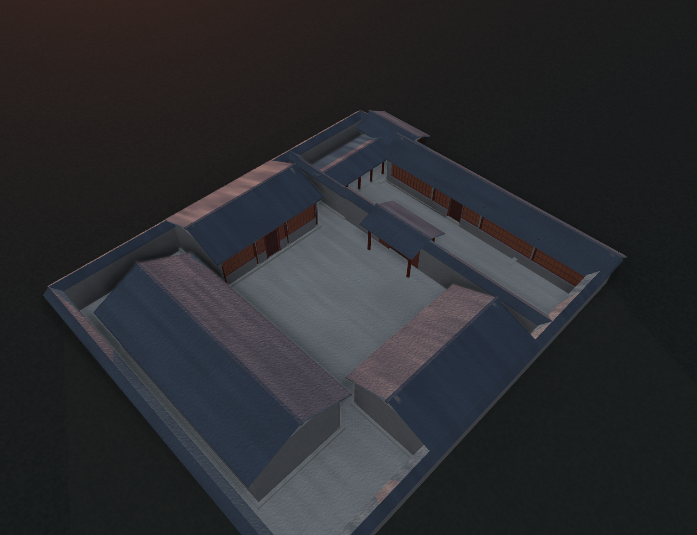
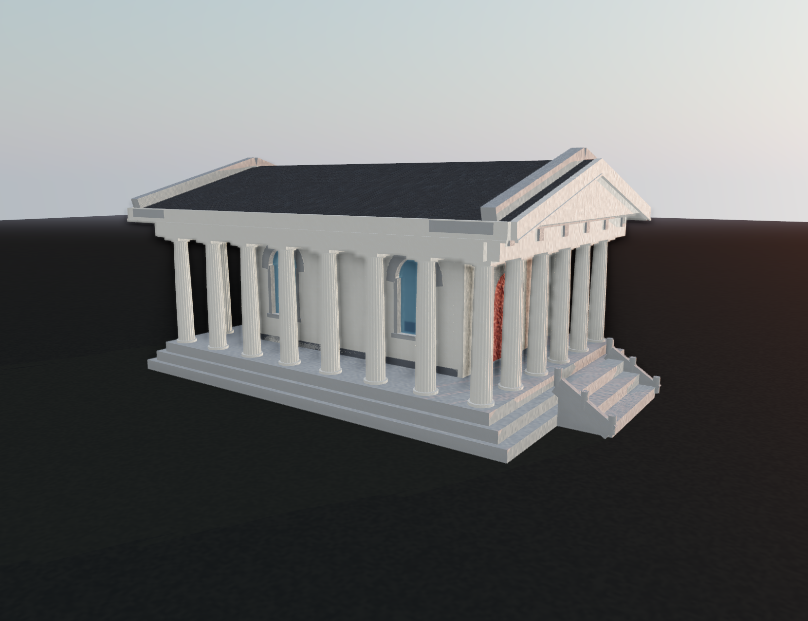
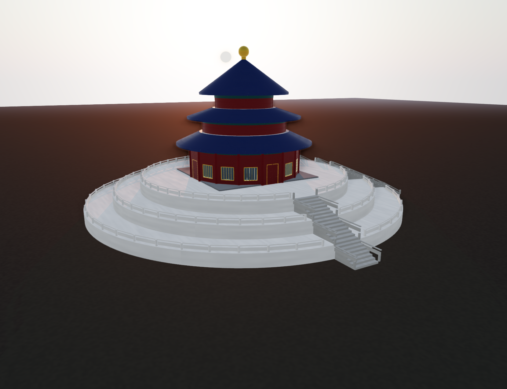
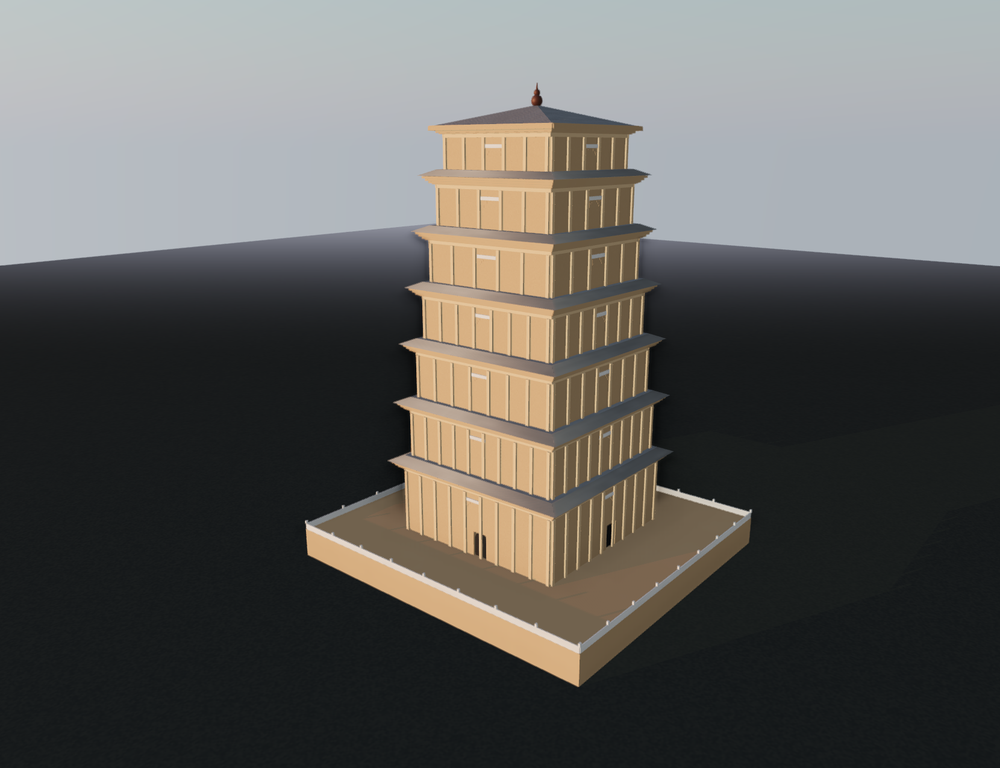
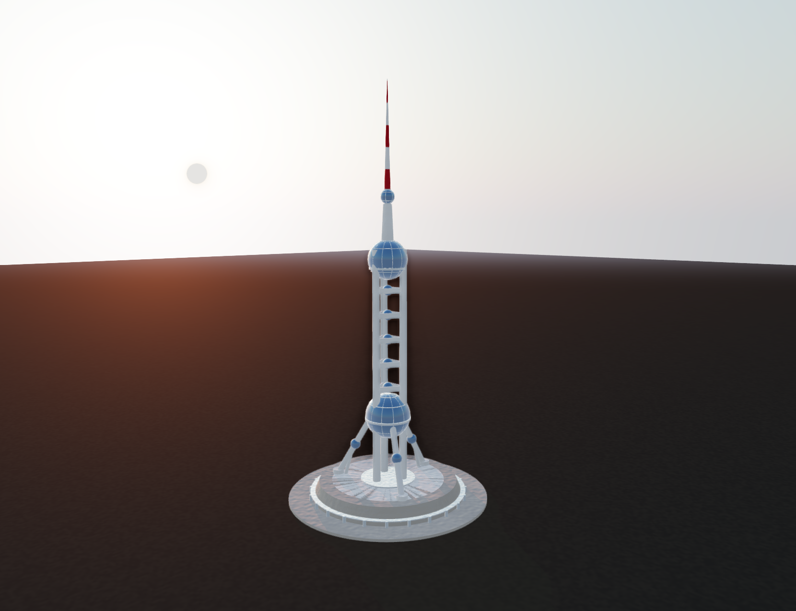
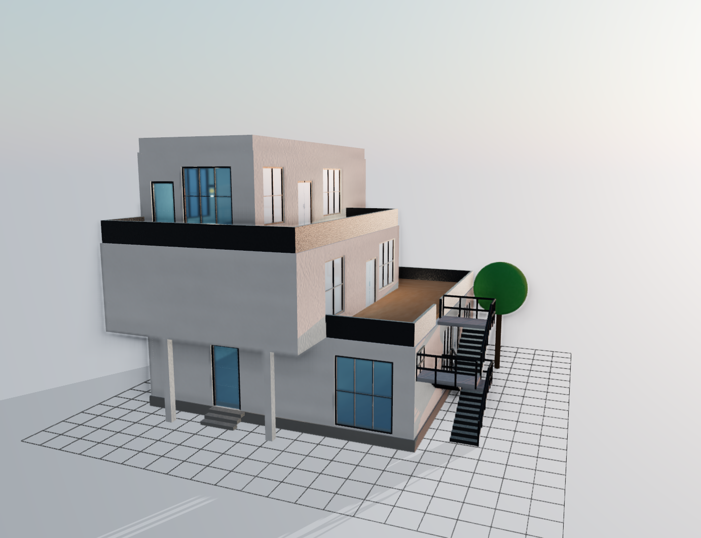

# WildAgent

## 前言

WildAgent 是一个 AI 辅助的参数化 3D 建筑编辑器。用户只需用自然语言描述想要的建筑，系统即可自动生成 .wild 蓝图文件并通过内置渲染引擎实时呈现 3D 效果。用户还可以通过拖拽、参数调节和对话交互对模型进行精细调整。项目核心由三部分组成：AI 驱动的蓝图生成、确定性的参数化渲染引擎、基于 Three.js 的实时 3D 预览。体验地址：www.zzzlew.asia

## 仓库结构

三个可独立运行的包加两个文档目录：

```text
WildAgent/
├── wild-server/      FastAPI 后端：Agent 编排、RAG、蓝图校验、WebSocket
├── wild-web/         Vue 编辑器：Three.js 实时预览、场景编辑、AI 对话
├── wild-core/        确定性几何引擎（TypeScript 包，被前端引用，无需单独启动）
├── docs/             与当前代码一致的正式文档
├── docs-dev/         开发过程记录与历史归档（已 gitignore，不进版本库）
└── 语言设计蓝图/     保留目录，内容已迁入 docs/specs 与 docs/design-languages
```

`wild-core` 是关键的分层：几何重建逻辑放在独立包里，由 `wild-web` 通过 `file:../wild-core` 依赖引用，后端不参与渲染计算。这样几何算法只有一份实现，前端渲染层只做 Three.js 适配。

阅读代码从 [代码阅读路线](docs/代码阅读路线.md) 开始，先沿一个请求找到节点，再按需追字段和共享方法。后端目录职责见 [Agent 代码入口](wild-server/app/agent/README.md)，具体符号位置见 [项目索引](docs/项目索引.md)。

## 核心概念

理解三个数据格式，就能读懂整个系统：

| 概念                          | 是什么                                                                             | 谁产生              | 作用                                                                   |
| ----------------------------- | ---------------------------------------------------------------------------------- | ------------------- | ---------------------------------------------------------------------- |
| **WILD Blueprint**（`.wild`） | 构件、尺寸、坐标、依附关系与材质的结构化描述，不含网格数据                         | 编译器或模型        | 交付与存档格式。同一份蓝图在相同引擎版本下可重建出相同几何             |
| **DesignDocument**            | 设计阶段的权威数据：体量、层数、立面轴网、屋顶、构件配额、已解析材质               | `architecture` 节点 | 供人工审核。批准后才允许落地为蓝图，避免设计还没定就开始建             |
| **ScenePatch**                | 结构化修改提案，共 16 种操作（增删改构件与元素、调材质、增删模板与实例、设行为等） | `patch` 节点或对话  | 所有场景修改的统一格式。Agent 只提提案，用户确认后才应用；应用失败回滚 |

三者构成一条清晰的链路：**设计（DesignDocument）→ 蓝图（Blueprint）→ 修改（ScenePatch）**。模型负责前两段的判断，确定性代码负责第三段的执行与回滚。

### 生成流程

```text
自然语言需求
   ↓
意图分类（generate / edit / chat）
   ↓
建筑方案  →  产出 DesignDocument（体量、立面、屋顶、材质意图）
   ↓
材质方案  →  受控归一化，不新增设计
   ↓
★ 设计审核  →  用户批准 / 要求修改（唯一的暂停点）
   ↓
任务展开  →  按图纸标记确定性展开为构件条目（此步不调模型）
   ↓
逐条执行  ⇄  失败重规划        ← 任务执行循环
   ↓
图纸装配  →  合并分片，引用闭合与槽位约束
   ↓
最终校验  →  完整校验流水线 + 错误报告
   ↓
有界回调修复（可选）→ 保存 → 实时渲染 → 继续手工编辑
```

进入 plan 后即使执行失败，也会编译已有分片。编译发现错误时最多调用一次模型生成局部修复并复检，不重新执行整轮任务；模型服务不可用时直接保留已有结果。修复前蓝图、修改操作和结果保存在编译记录中。校验失败或执行中断时仍保存 `.wild` 并尝试渲染，同时显示失败状态和完整错误。没有新结果时保留已有场景；草稿有错误也能继续修改、撤销和重做。无法渲染的内容仍保留在文件中，完全没有蓝图数据时不虚构建筑。

设计质量由模型决定，落地质量由编译器和校验器决定。整条链路只有一处需要人判断，就是设计审核。

## 常见问题

### 1. 给大模型提供 WILD 规范就能生成建筑，为什么还需要 WildAgent？

直接把规范和示例交给大模型，确实可以生成可渲染的 `.wild` 文件。已有的成功蓝图也说明，模型能力、提示词和参考资料本身就能决定很大一部分生成质量。如果只想偶尔生成一份建筑文件，单次调用是合理的选择。

WildAgent 将这些能力组织成一个持续使用的工作流程。当前建筑生成链路包括图纸设计、材质处理、方案确认、构件检索与实现、装配校验，以及前端 3D 预览，具体入口见 [Agent 工作流](wild-server/app/agent/graph.py)。

这个流程主要解决四件事：

- **组织生成过程。** 根据图纸安排构件任务，按需检索知识库；缺少必要形态资料时再查网络，避免用户每次手动准备完整规范和示例。
- **检查交付结果。** 对 JSON 格式、构件字段、引用和已支持的空间关系进行检查，保存失败原因并定向修订。检查通过后仍需查看渲染效果，确认建筑是否符合设计。
- **支持连续修改。** 编辑分支使用 ScenePatch 描述修改操作，结合当前场景和版本进行预检；确认后应用到蓝图，校验或重建失败时保留原场景。比如“把车库移到侧面”，需要同时处理位置、关联构件和现有场景。
- **保留改进依据。** 本地运行记录保存模型回复、检索命中、校验反馈和构件实现结果，便于区分提示词、知识库、代码或模型服务的问题。这些记录可以用于改进系统，但不会自动训练模型，也不能保证同类错误从此不再出现。

Agent 也会增加模型调用、耗时和维护成本。项目是否值得采用，要看它能否在反复生成和修改中减少人工操作、提高交付稳定性；这些收益需要通过实际测试验证。

想验证单次生成的效果，可以将 [WILD 蓝图规范](docs/specs/WILD_BLUEPRINT_SPEC.md) 和 [各建筑类型的书写规则与蓝图示范](docs/design-languages/) 提供给大模型，把输出保存为 `.wild`，再在查看器中加载。分别检查能否解析、能否渲染，以及设计和构件关系是否合理。
### 2. Codex、Claude、WorkBuddy、OpenCode 等通用 Agent 也能生成建筑，WildAgent 的优势是什么？

已有试用表明，通用编程 Agent 在读取项目规范、引擎代码和成功蓝图后，同样能生成效果不错的建筑。这说明，生成 WILD 的基础能力可以通过通用 Agent 复现。

但这恰好指出了 WildAgent 的差异所在：通用 Agent 之所以能写好 WILD，前提是它先**把整个项目读一遍**——引擎源码约 30 万字符，加上 WILD 规范与各建筑类型书写规则约 13 万字符，还要翻若干份成功蓝图，才敢落笔。这份知识每开一个新会话都要重新获取一次，且只沉淀在上下文里、随会话一起消失。

WildAgent 把这份知识固化在项目内的构件知识库（约 33 万字符，与引擎源码同量级），并按需检索：每轮只注入 `top_k=6` 个相关分片，上限 18000 字符，约占知识库总量的十八分之一——相对通用 Agent 每会话通读约 44 万字符，单轮注入量约为其二十三分之一，其余靠分片与过滤条件按需取。上下文成本由此从「读懂整个引擎」降到「取用当前构件的相关片段」。

由此产生的差异有四点：

- **上下文与调用成本。** 通用 Agent 的知识获取发生在每次会话；WildAgent 的知识沉淀在项目里，不随会话蒸发。切换模型、换机器、换协作者时，WILD 的构件约定、字段口径和当前引擎能力是同一份。
- **小修改不必经过对话。** 这是工作台与 Agent 的根本区别。拖拽移动、属性面板调参、场景树里删除构件、构件库直接新增，这些操作都不消耗模型调用，也不需要描述意图。通用 Agent 的每次改动都是一次自然语言往返，且模型可能改动你没要求改的地方。
- **表现层与生成分离，可独立扩展。** 光影运行时、世界外观、材质包和程序化材质都不依赖 Agent：世界光影设置面板直接调环境与光照参数，6 个风格包（`chinese`、`modern`、`european`、`glass_corporate`、`eco_contemporary`、`high_tech`）以版本化 JSON 独立编写并即时渲染，程序化材质与 PBR 素材各有自己的面板和运行时。这些能力可以各自单独演进、单独调试，不需要为了改一处表现去动生成链路。
- **生成结果留在同一工作台继续用。** 图纸、任务进度、实现结果、校验诊断和修改提案都在同一个界面，生成的文件直接进入渲染与编辑，不存在「导出后再手工处理」这一步。

后端同时是可复用的服务入口：模型调用、知识检索和生成编排都由后端承担，其他应用可以通过 REST/WebSocket 接口接入这些能力，不必复用前端。

方向上，这个项目会从「AI 生成建筑」逐步走向**网页版建筑制作工作台**：生成只是入口之一，编辑、材质、光影和构件库会持续向成熟建筑绘制软件的功能深度靠近。生成质量当前仍在完善，这条路线的价值更多取决于工作台部分。

需要说明的是：以上是架构差异，不是已验证的结论。通用 Agent 同样可以通过工具和工作流完成类似任务。专门化实现是否真的更好，应在相同模型、相近任务和一致验收标准下比较成功率、耗时、Token 消耗、修改准确性和最终渲染效果。当前还不能仅凭项目采用了 Agent 架构就认定它更优。

### 3. WildAgent 与 Meshy、Tripo 等 AI 3D 工具，以及大模型直接编写 Three.js，有什么区别？

区别主要在于资产的表达方式和编辑流程。

Meshy、Tripo 已经支持从文字生成 3D 模型，并提供材质或后处理能力，适合快速制作和探索 3D 资产。它们的具体能力应以 [Meshy 文档](https://docs.meshy.ai/en/webapp/text-to-3d) 和 [Tripo 文档](https://docs.tripo3d.ai/model-generation/text-to-model-v2-0-v2-5.html) 为准，不能笼统地称为“不可编辑的文件”。

WILD 将建筑保存为构件、尺寸、坐标、依附关系和材质描述，由引擎计算支持的几何形态。两种路线可以这样理解：

| 比较项     | 网格资产生成路线                       | WILD 参数化路线                                      |
| ---------- | -------------------------------------- | ---------------------------------------------------- |
| 资产描述   | 主要保存顶点、面和纹理等模型数据       | 保存构件类型、参数、引用和材质                       |
| 文件体积   | 随网格面数、纹理资源和压缩方式变化     | 参数化蓝图通常更小，几何在加载时由引擎生成           |
| 建筑语义   | 是否保留构件语义取决于生成及后处理流程 | 通过构件类型、语义 ID 和引用表达墙、门窗、屋顶等关系 |
| 修改方式   | 使用网格编辑、分件或再生成等工具       | 修改构件参数或结构化补丁，再编译与重建               |
| 适合的需求 | 快速获得造型和视觉资产                 | 按构件理解、调整和复用参数化建筑                     |
| 主要取舍   | 需要评估造型质量、拓扑和后续编辑成本   | 需要持续完善构件能力、参数协议和生成稳定性           |

**文件体积小也是 WILD 的一个重要优势。** 对于可由构件参数描述的建筑，蓝图只需保存尺寸、位置、形态和材质参数，加载时再由引擎生成网格，无需在文件中逐个保存生成后的顶点和面。因此，参数化蓝图通常能以更小的体积表达复杂建筑，便于保存、网络传输、版本比较和批量复用。若文件内嵌高清纹理等资源，体积也会相应增加；比较资产总大小时需要计入这些资源。

WILD 的可复现性指：在相同引擎版本、配置和资源下，同一份蓝图可以重建相同几何。模型每次设计的结果仍可能不同；跨版本兼容也需要协议维护和回归验证。

大模型直接编写 Three.js，同样可以实现参数化、构件关系和材质效果。WILD 将这些共用能力放入统一的数据协议、编译器和构件引擎，减少每份场景代码重复实现的工作。Three.js 继续承担展示，蓝图则用于保存和交换设计参数。

### 4. WildAgent 能生成多精细的模型？是否只能用于建筑？

精细度是用户选择的，不是模型临时决定的。生成前选定四档粒度，它同时决定设计范围和资源预算：

| 粒度            | 设计范围                                                                                                                                             | 迭代上限 | 模型调用 | 最大构件条目 |
| --------------- | ---------------------------------------------------------------------------------------------------------------------------------------------------- | -------: | -------: | -----------: |
| 低 `minimal`    | 建筑主体、必要门窗、屋顶、多层建筑的楼梯与基础照明；简洁构造与材质，默认不加装饰构件                                                                 |        4 |        6 |            8 |
| 中 `simple`     | 在此基础上按功能与风格适量加入阳台、露台、雨棚、栏杆、入口构件，完善立面与材质层次；默认不配家具                                                     |        6 |       10 |           12 |
| 高 `standard`   | 完整外观与构造细节：开口分格、檐口、门廊、柱饰、屋面节点与分层材质；按用途选构件，默认不做全套室内家具                                               |       12 |       24 |           24 |
| 极高 `detailed` | 再加入室内功能分区、通行空间与家具陈设（沙发、餐桌椅、床柜、厨卫），补充室内外照明与场地细节；家具必须作为带位置尺寸的构件标记写入，不能只写在文字里 |       20 |       40 |           40 |

这意味着精细度提升会同时放大表达深度和生成成本，两者由同一档位显式约束，而不是靠模型自觉。粒度提高应增加表达的层次，而不是简单增加门窗数量。

落到引擎，能力是有分级的，不是一句「都支持」：

- **基础几何构建器** 分为稳定与部分支持两档 —— 墙、楼板、楼梯、通用几何体为 `stable`；柱、梁、屋顶、洞口、家具、简化人物为 `partial`；程序化红砖为 `experimental`。注册表见 [wild-core 构件注册表](wild-core/src/primitive/registry.ts)。
- **组合构件编译器** 覆盖门窗、阳台、飘窗、雨棚、檐口、烟囱、栏杆、坡道、电梯、灯具共 11 类，并支持贴墙、贴路径、贴面三种附着方式，见 [wild-core/src/compiler](wild-core/src/compiler/)。
- **材质资源** 决定表面细节：PBR 参数与纹理、程序化材质、按米展开的 UV、法线通道。
- **渲染展示** 决定最终画面：光照、环境、阴影与色调映射。同一份蓝图在不同展示条件下呈现不同效果。

一个容易被忽略但很关键的设计：**做不到的能力会被显式说出来，而不是静默降级**。当前声明的能力缺口有两类 —— 室内房间平面与房间布局、场地语义（车库、后院、花园）。用户提到这类需求时，系统把对应条目标记为 `unsupported` 并写进交付清单，同时说明「本次不给出房间平面，但体量、外轮廓、门窗洞口与立面尺寸照常生成」，而不是硬编一个房间出来。要求「平面图」这类交付媒介不一致的表述只记提示，不判为能力缺失。

模型能描述一种形态，不代表引擎已经能完整实现它。扩展时优先组合现有构件；确实需要新的成形方式，再补规范、构建器和校验。

**不限于建筑。** 系统按交付对象区分两条并列链路：建筑链产出体量、立面、屋顶与结构；物件链产出家具、器物等单体，二者共用同一套构件、材质与校验协议。因此项目也能用于家具、亭台、景观构件及其他参数化物件。任意有机造型、扫描级细节和复杂人物仍需要补足相应能力，目前不具备。

### 5. WildAgent 还有哪些更大的应用场景？哪些是当前能力，哪些是未来设想？

当前重点是自然语言生成、参数化预览与编辑、构件知识检索，以及生成过程的记录和诊断。在这些能力稳定后，可以继续探索：

- **建筑方案交流与学习：** 快速生成方案，用可编辑构件比较体量、风格和空间组织，辅助理解设计。
- **游戏与交互场景制作：** 复用参数化建筑和景观构件，搭建街区、庭院或其他场景，并接入漫游与交互。
- **数字资产生产服务：** 将生成、修改和校验能力接入其他应用，让输出资产继续用于展示和编辑。
- **持续更新的数字世界：** 结合角色行为和场景状态，提出建筑布局或使用空间的调整建议。

“角色在建筑中生活”“Agent 根据使用情况自动规划街区”“世界持续自主演化”仍属于进一步的产品设想。实现它们需要寻路、行为系统、场景状态管理和操作授权等额外能力，现有建筑生成流程不能直接证明这些设想已经成立。

近期应先验证不同建筑类型的生成稳定性、设计与成品的一致性，以及连续修改的准确性。更大的应用建立在这些可编辑资产和可靠操作之上，再逐步接入场景与角色系统。

## 主要技术栈

| 层         | 选型                            | 版本             | 为什么是它                                                                                                                         |
| ---------- | ------------------------------- | ---------------- | ---------------------------------------------------------------------------------------------------------------------------------- |
| 编排       | LangGraph                       | ≥1.2.9           | 需要的是**带人工中断和状态回放**的工作流，而不是线性调用链。图拓扑集中在 `graph.py` 一处定义，节点实现分散在领域包，边界由测试守卫 |
| 模型接入   | LangChain + OpenAI SDK          | ≥1.3.14 / ≥2.0.0 | 面向 OpenAI-compatible 接口，实测 Qwen、GLM、DeepSeek 等多家服务可直接接入，不锁定单一供应商                                       |
| 向量检索   | ChromaDB                        | ≥1.1.0           | 与 LangChain 生态同源，支持增量 upsert 和 metadata 过滤，知识库更新不需要重建全库                                                  |
| 校验       | FastAPI + Pydantic + jsonschema | ≥0.139.2         | 同一份 Blueprint Schema 同时约束模型输出、后端交付和前端重建，三端不会各自解释                                                     |
| 前端       | Vue 3 + TypeScript + Vite       | 3.5 / 6.0 / 8.1  | 编辑器型应用需要强类型约束；Vite 的热更新让 `wild-core` 的引擎改动即时反映到画布                                                   |
| 渲染       | Three.js                        | ≥0.160.0         | 只负责展示与交互。几何计算全部在 `wild-core` 完成，避免两套实现不一致                                                              |
| 状态与 UI  | Pinia + Element Plus            | ≥2.1.7 / ≥2.14.3 | 会话、Agent Turn、场景状态需要按 request/session 精确归属，Pinia 的显式 store 边界便于隔离                                         |
| 运行时追踪 | LangSmith                       | ≥0.10.9          | 节点级状态观测与检索评测，是调试图行为的主要手段                                                                                   |

关键取舍：**LangGraph 只做编排，不承载业务判断。** 几何重建、校验、装配这些确定性逻辑都放在普通 Python 代码里，因此可以脱离模型单独测试。

## 界面展示

以下为 `.wild` 建筑示例在 WildAgent 3D 视口中的实际渲染效果，涵盖不同风格的住宅、庭院、古典建筑与地标造型。点击图片可查看原图，其他角度收录在下方的「更多视角」中。

### 别墅与住宅

| 三层现代别墅 | 三层欧式别墅 |
| :---: | :---: |
| [](images/introduce/别墅/三层平顶挑檐现代别墅/wild-viewport-2026-10-13-07-27-33.png) | [](images/introduce/别墅/三层欧式别墅/wild-viewport-2026-10-13-07-29-32.png) |
| 平顶挑檐与水平阳台，结合大面积玻璃和简洁立面。 | 坡屋顶、老虎窗与烟囱，搭配入口柱廊和阳台栏杆。 |

| 新中式别墅 · 门廊与露台 | 新中式别墅 · 错落屋面 |
| :---: | :---: |
| [](images/introduce/别墅/三层新中式别墅/wild-viewport-2026-10-13-07-26-50.png) | [](images/introduce/别墅/三层新中式别墅/wild-viewport-2026-10-13-07-28-45.png) |
| 白墙、深色屋面与木柱门廊，上层退台形成露台。 | 中部抬高、两侧展开，以错落坡屋顶组织建筑轮廓。 |

### 庭院与古典建筑

| 北京四合院 | 欧式古典殿宇 |
| :---: | :---: |
| [](images/introduce/北京四合院/wild-viewport-2026-10-13-07-23-28.png) | [](images/introduce/欧式古典殿宇/wild-viewport-2026-10-13-07-24-59.png) |
| 多组房屋围合院落，展示庭院留空、屋面组合与廊道关系。 | 柱列环绕内殿，结合三角山花、双坡屋面和台阶基座。 |

| 天坛祈年殿 | 西安大雁塔 |
| :---: | :---: |
| [](images/introduce/天坛祈年殿/wild-viewport-2026-10-13-07-25-33.png) | [](images/introduce/西安大雁塔/wild-viewport-2026-10-13-07-26-03.png) |
| 圆形殿身与三重屋檐，结合环形台基、栏杆和入口台阶。 | 逐层收分的塔身体量，展示重复层级、层间出檐与顶部造型。 |

### 地标与商业建筑

| 东方明珠电视塔 | 咖啡厅 |
| :---: | :---: |
| [](images/introduce/东方明珠电视塔/wild-viewport-2026-10-13-07-24-21.png) | [](images/introduce/咖啡厅/wild-viewport-2026-10-14-07-26-12.png) |
| 球体、竖向塔身与斜撑组合，展示非住宅类地标造型。 | 退台体量搭配室外楼梯、露台栏杆与玻璃门窗。 |

<details>
<summary>更多视角（点击链接查看原图）</summary>

| 建筑示例 | 视角一 | 视角二 |
| --- | --- | --- |
| 三层现代别墅 | [查看图片](images/introduce/别墅/三层平顶挑檐现代别墅/wild-viewport-2026-10-13-07-27-31.png) | [查看图片](images/introduce/别墅/三层平顶挑檐现代别墅/wild-viewport-2026-10-13-07-27-39.png) |
| 三层欧式别墅 | [查看图片](images/introduce/别墅/三层欧式别墅/wild-viewport-2026-10-13-07-29-35.png) | [查看图片](images/introduce/别墅/三层欧式别墅/wild-viewport-2026-10-13-07-29-38.png) |
| 新中式别墅 · 门廊与露台 | [查看图片](images/introduce/别墅/三层新中式别墅/wild-viewport-2026-10-13-07-26-53.png) | [查看图片](images/introduce/别墅/三层新中式别墅/wild-viewport-2026-10-13-07-27-02.png) |
| 新中式别墅 · 错落屋面 | [查看图片](images/introduce/别墅/三层新中式别墅/wild-viewport-2026-10-13-07-28-48.png) | [查看图片](images/introduce/别墅/三层新中式别墅/wild-viewport-2026-10-13-07-28-50.png) |
| 北京四合院 | [查看图片](images/introduce/北京四合院/wild-viewport-2026-10-13-07-23-20.png) | [查看图片](images/introduce/北京四合院/wild-viewport-2026-10-13-07-23-49.png) |
| 欧式古典殿宇 | [查看图片](images/introduce/欧式古典殿宇/wild-viewport-2026-10-13-07-24-49.png) | [查看图片](images/introduce/欧式古典殿宇/wild-viewport-2026-10-13-07-25-09.png) |
| 天坛祈年殿 | [查看图片](images/introduce/天坛祈年殿/wild-viewport-2026-10-13-07-25-28.png) | [查看图片](images/introduce/天坛祈年殿/wild-viewport-2026-10-13-07-25-36.png) |
| 西安大雁塔 | [查看图片](images/introduce/西安大雁塔/wild-viewport-2026-10-13-07-26-00.png) | [查看图片](images/introduce/西安大雁塔/wild-viewport-2026-10-13-07-26-05.png) |
| 咖啡厅 | [查看图片](images/introduce/咖啡厅/wild-viewport-2026-10-14-07-26-07.png) | [查看图片](images/introduce/咖啡厅/wild-viewport-2026-10-14-07-26-20.png) |

</details>

## 启动方法

仓库由三个可独立运行的包组成：`wild-server`（FastAPI 后端）、`wild-web`（Vue 编辑器）、`wild-core`（几何引擎，被前端以 `file:` 依赖引用，无需单独启动），另有一个用于图调试的 LangSmith Studio。以下命令默认在仓库根目录 `E:\AgentProject\WildAgent` 下用 PowerShell 执行。

### 环境要求

- Python 3.12+ 与 [uv](https://docs.astral.sh/uv/)（版本见 `wild-server/.python-version`）
- Node.js 与 npm（版本见 `wild-web/package.json`）
- 一个 OpenAI-compatible Chat 模型；使用语义检索还需单独配置 Embedding 模型

### 1. 后端：FastAPI

后端配置统一读取 `wild-server/.env`，路径由代码按 `wild-server` 目录解析，与启动时的当前目录无关。先复制模板并填入模型与密钥：

```powershell
Copy-Item wild-server/.env.example wild-server/.env
```

首次拉取依赖（同步开发依赖，供测试与 Studio 使用）：

```powershell
cd wild-server
uv sync --dev
```

`uv run` 需在 `wild-server` 目录执行，以便读取该目录的 `pyproject.toml` 与 `uv.lock`。以下命令提供等价可选写法，日常开发任选其一：

```powershell
# 1. FastAPI 官方 CLI：读取 [tool.fastapi] entrypoint = "main:app"，
#    自动发现 main.py，默认监听 127.0.0.1:8000 且已开启热重载
uv run fastapi dev

# 2. 显式指定入口文件（等价，仍默认带 --reload）
uv run fastapi dev main.py
uv run fastapi dev main.py --reload

# 3. 指定监听地址与端口（容器或局域网调试需要 --host 0.0.0.0）
uv run fastapi dev main.py --reload --host 127.0.0.1 --port 8000

# 4. 生产式启动：关闭热重载，不监听 127.0.0.1
uv run fastapi run main:app --host 0.0.0.0 --port 8000

# 5. 直接使用 uvicorn（历史文档与部分脚本沿用）
uv run uvicorn main:app --host 127.0.0.1 --port 8000 --reload

# 6. 绕过 uv，直接调用虚拟环境中的 CLI
.\.venv\Scripts\fastapi.exe dev
```

几点差异需要留意：`fastapi dev` 默认就是 reload，等价于 `fastapi run` 加自动重载并绑定 `127.0.0.1`；`--reload` 是资源密集型选项，正式环境请用 `fastapi run`。`fastapi dev` 会自动发现模块中的 `app` 对象，也可用 `--app <变量名>` 或 `-e module:app` 明确指定。启动后可用 `uv run fastapi dev -v` 查看应用是如何被发现和导入的。

服务健康检查入口为 `/api/sessions`，Agent 通道为 `/ws/agent`。关闭时按 `Ctrl+C`。

### 2. 前端：Vite

```powershell
cd wild-web
npm install
npm run dev
```

开发服务器默认监听 `5173`，`vite.config.ts` 已把 `/api` 与 `/ws` 代理到 `http://127.0.0.1:8000`，因此需先启动后端。`wild-core` 通过 `file:../wild-core` 链接到 `node_modules`，改动引擎源码后由 Vite 热更新生效，无需重新安装。

其他脚本：

```powershell
npm run build          # vue-tsc 类型检查 + 生产构建
npm run preview        # 预览 dist 构建产物
npm run check:core     # 校验 wild-core 契约与 schema
npm run check:compiler # 校验构件编译器
```

引擎包自身的类型检查需在 `wild-core` 下单独执行 `npm install` 与 `npm run typecheck`。

### 3. LangSmith Studio：可视化调试 LangGraph

依赖 `dev` 组的 `langgraph-api`、`langgraph-cli` 与 `langsmith`（由上面的 `uv sync --dev` 安装），并在 `wild-server/.env` 中补充：

```dotenv
LANGSMITH_API_KEY=填写你的密钥
LANGSMITH_TRACING=true
LANGSMITH_PROJECT=wildagent
```

Studio 的 CLI 按命令执行目录解析依赖、图文件和环境文件，因此必须在 `wild-server` 目录执行：

```powershell
cd wild-server
uv run langgraph dev --config langsmith_tools/langgraph.json
```

配置放在子目录，必须用 `--config` 指定；`langgraph.json` 中的 `"."` 和 `".env"` 均相对 `wild-server` 解析。若运行原图时出现同步 I/O 的 `BlockingError`，可临时追加 `--allow-blocking`（只关闭报错，不修复阻塞本身）：

```powershell
uv run langgraph dev --config langsmith_tools/langgraph.json --allow-blocking
```

启动后打开终端给出的 Studio 链接，选择 `wildagent` 图，输入可参考 `langsmith_tools/studio-input.example.json`。Studio 使用独立的 `GenerationInput` 输入契约，不接管原页面的 WebSocket 会话与前端渲染。详见 [langsmith_tools/README.md](wild-server/langsmith_tools/README.md)。

### 4. Docker 本地部署

```powershell
docker compose up -d --build
docker compose logs -f server
```

`server` 映射 `8000:8000`，`web` 映射 `80:80` 并由 nginx 反向代理。

### 相关文档

- [开发与测试](docs/DEVELOPMENT.md)：配置说明、变更验证清单与常见排查顺序
- [测试文件使用指南](docs/TESTING.md)
- [服务器部署与运维](docs/DEPLOYMENT.md)


##  Agent 服务接口 

==可作为一个微服务接入其他项目==

后端不依赖前端即可使用。生成能力通过 REST 与 WebSocket 暴露，前端只是它的一个客户端。

| 通道     | 端点                                                        | 用途                                                                             |
| -------- | ----------------------------------------------------------- | -------------------------------------------------------------------------------- |
| 实时     | `WS /ws/agent`                                              | Agent 全部交互。消息按 `protocol_version` 封装，推送结构化步骤事件与流式思考内容 |
| 会话     | `GET/POST /api/sessions`                                    | 列出与创建会话                                                                   |
| 会话     | `GET/POST /api/sessions/{id}/messages`                      | 读取与追加对话消息                                                               |
| 会话     | `GET/PUT /api/sessions/{id}/turns`                          | 读取与回写 Agent Turn（按 `request_id` 归属，含中断恢复状态）                    |
| 会话     | `GET /api/sessions/{id}/preview.svg`                        | 取当前设计图纸的 SVG 预览                                                        |
| 会话     | `POST /api/sessions/{id}/approve`                           | 提交设计审核结论（批准 / 要求修改）                                              |
| 场景     | `GET/PUT/DELETE /api/scenes/{date}/{filename}`              | 读写与删除 `.wild` 蓝图，按日期分目录存放                                        |
| 配置     | `GET/POST /api/config/llm`、`POST /api/config/llm/test`     | 查询与保存全站模型配置；测试接口只探测输入框当前候选值，不写盘                   |
| 资产     | `POST /api/assets/pbr`、`GET /api/assets/{id}/files/{name}` | PBR 纹理上传与按 `assetId` 取图                                                  |
| 设计契约 | `GET /api/designs/schema`                                   | DesignDocument 的 JSON Schema，供客户端做前置校验                                |
| 检索观测 | `GET /api/rag/*`                                            | RAGTrace 查询与反馈回收                                                          |
| 健康     | `GET /`、`GET /health/ready`                                | 存活探测与 RAG 真实就绪状态（部署探针用后者）                                    |

接入方需要知道的三个约定：

- **产物只在最终校验全通过后才返回。** 返回的蓝图带服务端权威的 `filename` / `file_url`，客户端不应自行拼接路径。
- **删除会话会永久删除对应文件**，没有回收站。生产环境需要快照策略。
- **`/health/ready` 会读真实的向量库状态**，Embedding 或 Chroma 初始化失败时返回 503，而不是假装健康。

接口契约与事件协议详见 [Agent 与 AI 对话设计](docs/agent/AGENT_AND_CHAT.md)。

## 已知限制

当前不具备、且不应被误解为已实现的能力：

| 限制                     | 现状                                                                                                                                  |
| ------------------------ | ------------------------------------------------------------------------------------------------------------------------------------- |
| 室内房间平面             | 不设计房间位置、功能分区与内部隔墙。用户要求时会显式标记为 `unsupported` 并说明本次不给出房间平面，但体量、外轮廓、门窗与立面照常生成 |
| 场地语义                 | 不处理车库、后院、花园等室外空间划分                                                                                                  |
| 二维平面图               | 不产出平面图与剖面图。体量与立面以图纸 SVG 呈现，这类要求只记提示、不判为能力缺失                                                     |
| 有机造型与扫描级细节     | 参数化引擎不适用于任意有机曲面、扫描网格或真实复杂人物                                                                                |
| 部分几何构建器成熟度不一 | 墙、楼板、楼梯、通用几何体为稳定级；柱、梁、屋顶、洞口、家具、简化人物为部分支持；程序化红砖为实验级                                  |
| 生成稳定性               | 不同建筑类型的生成成功率、设计与成品的一致性仍在量化中，尚不能承诺稳定复现                                                            |

被判定为能力缺失的需求不会被静默降级，而是写入交付清单并附替代路径说明。需要预先知道系统做不到什么，比事后在成品里发现更省事。


## 项目迭代思路演进过程

完整记录：[wildagent 项目的演进过程.md](wildagent 项目的演进过程.md)

这份文件是开发过程的思考留痕，含 1000 余行，内容混合了仍然有效的结论和已被后续架构取代的探索（如早期的 ExecutionPlan 与 `planning/` 目录），**不作为当前实现依据**。当前架构以 [架构说明](docs/ARCHITECTURE.md) 和 [项目索引](docs/项目索引.md) 为准。

留存的几条主线：

- **知识库的设计与消费方式**：为什么把构件知识拆成分片并按 metadata 过滤，而不是把整份规范塞进提示词。
- **Agent 设计模式的取舍**：从固定流水线转向「动态任务 + 确定性执行」，以及为什么最终放弃让模型直接调度代码。
- **用 LangSmith Trace 定位问题**：节点状态该看什么、怎么比较相邻节点的 State，这是本项目多数生成质量问题的主要排查手段。
- **vibecoding 的瓶颈**：把生成质量寄托在「让模型多试几遍」上会遇到哪些天花板。
- **Prompt 的组织方式**：输出形态声明、字段白名单、生成红线与检索片段注入的分工。

其中「vibecoding 的瓶颈」和「用 Trace 定位问题」两节对理解本项目的工程判断最有帮助。


