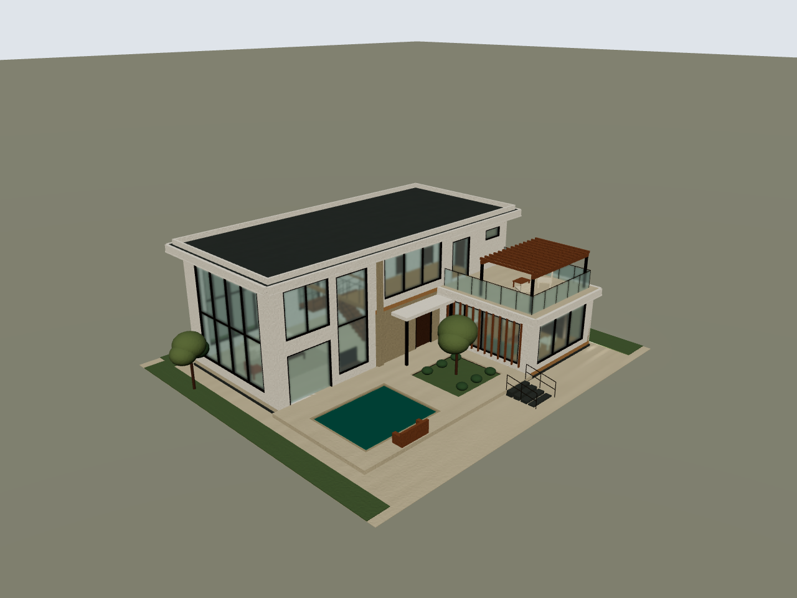

# 10 月 20 日：汀院别墅与 Agent 流程复盘

**状态：实验代码已回退至 `7f43ca2`。** 本目录的设计、优化和失败测试保留为历史记录，不代表当前代码。见[代码回退记录](10-代码回退记录.md)。

- [打开新的 WILD：汀院别墅-Codex.wild](汀院别墅-Codex.wild)
- [实际生成记录：用了什么、怎样设计、怎样检查、哪里失败](01-汀院别墅实际生成记录.md)
- [当前 Agent 流程对比与简化建议](02-当前Agent流程对比与简化建议.md)
- [已实施的 Agent 流程优化与验证结果](03-Agent流程优化实施记录.md)
- [设计图纸字段整理：从哪个类开始阅读](05-设计图纸字段整理.md)
- [新版设计图纸与 architecture：本轮实际改动和输出入口](06-新版设计图纸与architecture.md)
- [当前 architecture 修复与真实模型测试](architecture最后修复/README.md)
- [旧版图纸历史样例：汀院别墅（不能用于 design-facts/2）](汀院别墅-新版设计图纸.json)
- [设计包清理：保留 3 个文件，删除旧协议及其实现](07-design包清理.md)
- [architecture 如何生成图纸，以及 Studio 断点怎么观察](08-architecture流程与Studio观测.md)
- [任务范围与验收口径](00-本次任务与证据说明.md)

180 个原生元素、45 个组件、23 种材料；真实引擎编译和重建均为 0 错误。最终四个标准视角与三个补充检查视角保存在 `汀院别墅-过程证据/`。空间检查未覆盖的形态原样保留待复核，不把渲染成功写成完整工程验收。

上方别墅制作阶段只新增交付及过程文件。随后按用户要求实施了 Agent 源码优化：明确的原生参数直接转换，通路冲突提前检查，详见实施记录。目录中原有的补充版语言文档保留。
