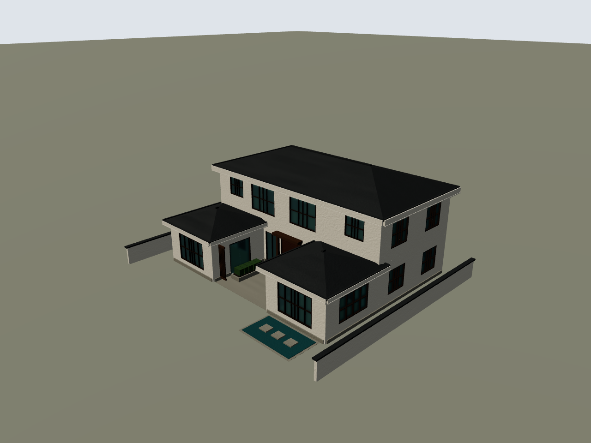

# 栖庭 · 新中式庭院别墅

后续项目实现见 [空间图纸与验收全量优化记录](项目全量优化实施记录.md)。该轮已修改项目代码，按用户要求尚未测试或重新生成；下面保留优化前栖庭基线的实际结果。

正式交付文件为 [栖庭-新中式别墅.wild](栖庭-新中式别墅.wild)，可以直接导入 WildAgent 编辑器。

采用两层主楼、两侧单层厢房、中央露天庭院，白墙、炭灰四坡屋面、深木色门窗和格栅、灰石勒脚与浅水院。主体平面包络 16×13 米，庭院 6×5 米，楼面顶标高 0 / 3.4 米，最高点约 8.47 米。两层主楼与厢房的名义楼面合计 306 平方米，扣除二层楼梯井后约 295.34 平方米；这是模型的几何面积。

先创建项目当前的 `DesignDocument design/1.0`，再投影为构件标记、实现分片、验收、装配和渲染。没有复制历史别墅，未改应用源码。本次由 Codex 编写设计与实现，复用项目运行时函数，不是调用完整 LangGraph 的自动生成记录。

| 内容 | 文件 |
| --- | --- |
| 最终设计图纸，revision=2 | [01-栖庭别墅-设计图纸.json](01-栖庭别墅-设计图纸.json) |
| 完整创建流程、修订原因和复现命令 | [创建流程.md](创建流程.md) |
| 设计作者脚本 | [00-创建设计图纸.py](00-创建设计图纸.py) |
| 此图专用实现及项目装配入口调用 | [02-编译图纸.py](02-编译图纸.py) |
| 两层设计示意 | [一层](03-第1层设计图.svg)、[二层](03-第2层设计图.svg) |
| 原始投影、宿主和 50 个标记 | [03-设计投影与构件标记.json](03-设计投影与构件标记.json) |
| 实现片段 / 装配输入 | [片段](04-构件实现片段.json)、[状态](04-装配输入状态.json) |
| 完整验收报告 | [05-编译与验收报告.json](05-编译与验收报告.json) |
| 正式模型真实渲染 | [正面](06-真实渲染/front.png)、[侧面](06-真实渲染/side.png)、[俯视](06-真实渲染/top.png)、[透视](06-真实渲染/perspective.png) |
| 楼梯井和空间分区剖切 | [俯视](07-剖切渲染/top.png)、[透视](07-剖切渲染/perspective.png) |
| 几何与文件来源核对 | [08-几何与来源复核.json](08-几何与来源复核.json) |

最终模型包含 118 个 element、39 个 component。50 个图纸标记全部落实，整图验收错误为 0、流水线警告为 0；Chromium 中真实调用项目引擎，编译错误、重建错误和未映射材质均为 0。正式模型与剖切副本共保存 8 张截图。

项目报告仍保留 9 项组合造型 `needs_review`；截图提供外观复核证据，未改写自动报告。屋面采用低坡四坡面表达，没有逐片瓦、斗拱或复杂曲面飞檐；室内保留功能分区、内墙、门和楼梯，未做完整家具、厨卫设备与施工深化。
