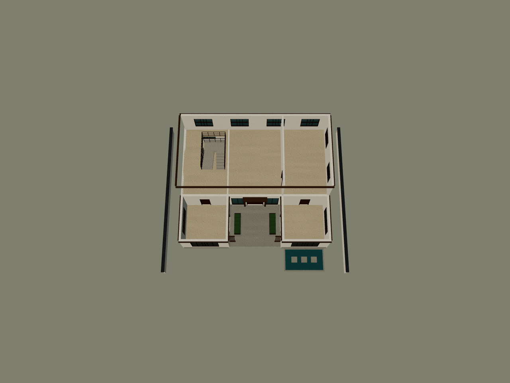

# 栖庭别墅创建流程

日期：2026-10-21。目标是在本目录交付一份能由当前 WildAgent 引擎渲染的新中式别墅，以及能核对设计来源和编译过程的文件。

## 1. 先确认项目当前实际契约

扫描了仓库结构、Git 工作区、设计与编译入口、WILD Schema 和浏览器渲染脚本。发现 `docs/10月20日优化/06-新版设计图纸与architecture.md` 明确标记实验已回退，`app/design/facts.py` 已不存在，因此没有使用历史 `DesignFacts / 2`。

本次依据当前源码：

| 职责 | 当前项目入口 |
| --- | --- |
| 设计文档唯一类型 | [contracts.py](../../wild-server/app/design/contracts.py)：`DesignDocument`、`ArchitectureDecisions`、`ComponentInstance` |
| 设计坐标与挑空 | [coordinates.py](../../wild-server/app/design/coordinates.py)：`design_geometry_context`、`floor_elevations` |
| 设计示意投影 | [compilation.py](../../wild-server/app/design/compilation.py)：`project_drawing` |
| 标记展开与依赖 | [markers.py](../../wild-server/app/design/markers.py)：`component_markers` |
| 单标记实现验收 | [implementation.py](../../wild-server/app/agent/plan/implementation.py)：`_accept_group` |
| 分片装配及关系处理 | [compile.py](../../wild-server/app/agent/design_flow/compile.py)：`_assemble_with_relations` |
| 原始候选完整验收 | [candidate.py](../../wild-server/app/agent/validation/candidate.py)：`evaluate_candidate` |
| 实际引擎渲染 | [render-baseline.mjs](../../wild-web/scripts/render-baseline.mjs) |

项目当前建筑主线为 `architecture → material_plan → design_review → plan → execute / replanner → compile → final_validate`。本次按这条职责链组织产物，由 Codex 完成方案、材料和构件实现，调用项目现有投影、片段验收、装配与整图验收函数。没有调用完整 LangGraph，没有调用外部模型，也没有将人工流程伪装成 Agent trace。

`app/design/compilation.py::compile_document` 虽仍存在，但注明是离线旧适配器；本次没有把它当成当前 Agent 建筑主线。没有修改应用实现来迁就此栋建筑。

## 2. 创建设计图纸

用户未指定楼层、面积和朝向，作者选择两层主楼、单层东西厢房和南向开口庭院。平面点采用世界 X/Z 坐标，X 向右、Y 向上；南立面朝 Z 减小方向。体量的 `x/z` 是西南角起点，`width/depth` 是宽深。

| 体量 | X 范围 | Z 范围 | 层数 | 用途 |
| --- | --- | --- | --- | --- |
| main | 0～16 | 5～13 | 1～2 | 起居、餐厨、卧室套间分区及楼梯厅 |
| west | 0～5 | 0～5 | 1 | 长辈房 |
| east | 11～16 | 0～5 | 1 | 茶室 |
| 露天庭院 | 5～11 | 0～5 | 无上盖 | 中轴通路、绿植槽、格栅 |

[00-创建设计图纸.py](00-创建设计图纸.py) 输出 [01-栖庭别墅-设计图纸.json](01-栖庭别墅-设计图纸.json)，经当前 Pydantic 类型实际解析，`schema_version=design/1.0`、`decisions.kind=architecture`。最终为 `revision=2`。

图纸使用项目已有的 `massing / complexity / volumes / structural_grid / envelope / facades / roof / circulation / materials / floor_layouts / components / design_intent`。每扇门窗显式声明宿主、沿墙 offset、窗台、宽高和形式。屋顶、双跑楼梯、栏杆、门套、格栅、勒脚、景观都在 components 中列明。

`construction`、`materials.implementation_materials` 与 `form.recipe` 是当前契约允许的扩展设计数据，在本次作者文件中显式保存；它们不是新增的项目通用协议，也不能据此声称在线 Agent 已具备这份专用脚本的全部实现能力。箱体组合的分件记录为 `[中心X,Y,Z,宽,高,深,材料]`，尺寸和坐标均来自本图。

材料主角色按项目的 `ResolvedMaterialPlan` 保存；石材、绿植、土壤、水面等附加材料也在源图纸中定义。没有外部图片、贴图下载或模型资源依赖。图纸保持 draft，未伪造用户批准记录。

## 3. 投影、按标记实现和验收

[02-编译图纸.py](02-编译图纸.py) 读取已保存的 JSON，调用 `project_drawing`。输出两层 SVG，以及 [03-设计投影与构件标记.json](03-设计投影与构件标记.json)。SVG 是坐标示意，真实视觉由后续引擎截图证明。

49 个显式组件，加上程序建立的 `building_body`，共 50 个标记。按标记依赖排序，先实现建筑主体，再实现门窗、屋面及附属构件。每份实现都经过项目原有 `_accept_group`，生成带实体 ID、指纹和几何复核结果的落实记录，没有手工给未经检查的实体盖“已通过”。

主体按体量分别铺板，保留 U 形空缺；两厢背面设计为 open，复用主楼南墙，避免重复共面墙。门窗使用原生组件与真实 `parentWall`；画玻璃平面不能替代墙上开洞。门窗局部坐标的 Y 是世界底标高，二层需要加上 3.4 米楼面标高。

楼梯分为两段原生 stair 和半平台：每跑 10 级，级高 0.17 米，踏深 0.29 米，梯宽 1.2 米，梯间净缝 0.2 米，半平台进深 1.2 米。图纸明确声明连接 1→2 层。

原始实现和装配输入分别保存在 [04-构件实现片段.json](04-构件实现片段.json) 与 [04-装配输入状态.json](04-装配输入状态.json)。这些文件能核对每个图纸标记具体落成了哪些实体。

## 4. 实际遇到的问题与修订

| 阶段 | 发现 | 本次处理 |
| --- | --- | --- |
| Python 运行环境 | 当前工具进程缺少 SystemRoot / windir，导入 asyncio 报 WinError 10106 | 只在本次执行进程设置为 C:\Windows；未改系统配置 |
| 整图验收模块导入 | 服务模块导入会初始化 RAG 与模型客户端，环境 SOCKS 代理缺 socksio | 本次离线子进程关闭 RAG 与自动同步，清空代理变量；不安装依赖、不改 .env |
| 门窗片段 | door 需要 interaction；window 不接受 interaction.mode=fixed | 图纸明确门为 swing、窗为 slide，复用引擎枚举 |
| 石脚片段 | 石脚内表面与墙外表面共面，原校验器报告闪烁风险 | 设计石脚厚度改为 0.08 米，形成 0.01 米嵌入；按门窗分段，保留洞口通行 |
| 材料整图检查 | lightingCondition 必须为 D65_noon，day 不合法 | 修订材料输入；[修订前报告](05-材质修订前验收报告.json)保留 |
| 首轮楼梯剖切 | 自动切板只处理穿过楼板标高的梯段，第一跑与半平台上空仍有板 | 将完整楼梯井作为二层 void 写回图纸，按挑空分片铺板；井口三边护栏延伸到井边，保留南侧二层出口承接板 |
| 剖切副本 | 单独删墙会使其门窗宿主悬空 | 剖切脚本连同依附件一起移除；不改正式 WILD |

楼梯修订前保留 [r1 图纸](01-r1-楼梯井复核前.json)和 [r1 验收报告](05-r1-楼梯井复核前报告.json)。r1 的几何流水线通过，并不能证明头部空间完整，这是必须实际查看剖切的原因。

最终 r2 在 `floor_layouts` 中声明二层楼梯井：X=11.35～13.95、Z=8～12.1，面积 10.66 平方米。完整覆盖两跑和半平台上空；作者实现器按这份设计扣板，再通过现有装配函数。自动装配切板入口仍被调用，最终不需要额外补洞。

## 5. 装配与最终检查

调用项目 `_assemble_with_relations` 合并已验收片段，执行既有楼梯楼板关系处理，保持设计 hash 与落实记录一致。然后调用只读 `evaluate_candidate`，把报告绑定到最终原始候选。

正式输出为 [栖庭-新中式别墅.wild](栖庭-新中式别墅.wild)。[05-编译与验收报告.json](05-编译与验收报告.json)记录源 JSON SHA-256、设计 hash、全部实现记录和原始验收快照；`source_unchanged=true`，编译阶段没有改源图纸。

| 检查 | 最终结果 |
| --- | --- |
| 图纸标记 | 50 个，全部 implemented，缺失 / 舍弃均为 0 |
| Blueprint | 118 个 element、39 个 component |
| 整图验收 | errors=[]，warning_count=0 |
| 建筑首层 / 二层楼面几何面积 | 178 / 117.34 平方米 |
| 建筑楼板覆盖庭院的面积 | 两层均为 0 |
| 二层板覆盖完整楼梯井的面积 | 0 |
| 模型 API 调用 | 0 |
| 正式模型 / 剖切副本的引擎编译错误 | 0 / 0 |
| 正式模型 / 剖切副本的几何重建错误 | 0 / 0 |
| 未映射材质 | 0 |

原始履约报告仍有 9 项 `needs_review`，分别是三组体量线脚、入口门套、两组格栅、场地、种植槽和前庭景观。这些属于组合形态，项目判据明确要求视觉复核。本次查看了外观、俯视及楼梯剖切，保留截图与观察，不将自动报告中的 `needs_review` 改成 satisfied，也不将这些项目算作已被机器完全证明。

[08-几何与来源复核.json](08-几何与来源复核.json)额外核对源图纸 SHA 与编译报告、正式 WILD SHA 与渲染 manifest 一致，并按实际 floor 矩形核对庭院和楼梯井覆盖面积。

## 6. 真实渲染与视觉观察

执行项目 `wild-web/scripts/render-baseline.mjs`，加载当前 `wild-core` 源码，在 Chromium 的真实 WebGL 环境中完成组件编译、几何重建与 `wild-web/createSceneGroupFromEntity` 渲染。不是手绘效果图或另一个渲染器的近似图。

正式模型生成 488 个 mesh，输出 front / side / top / perspective 四张 1280×960 截图。[render_manifest.json](06-真实渲染/render_manifest.json)包含输入 SHA、引擎源码摘要、浏览器版本、设置、网格数和错误数。

观察记录：主楼与两厢有清晰高低关系，三块四坡屋盖完整，中央庭院没有屋顶封盖；门套、两侧木格栅、石脚、种植槽与浅水院可见。灰瓦意图以深灰四坡面和屋脊表达，未制作逐片瓦。基线照明下屋面和玻璃偏暗，截图保留了原脚本曝光。

[07-创建剖切.py](07-创建剖切.py)从正式 WILD 派生检查副本，移除三组屋面、三段二层墙及其依附门窗，共 28 个实体，清单保存在 [07-剖切移除清单.json](07-剖切移除清单.json)。正式 WILD 保留完整外壳。剖切截图能看到完整梯井、两跑踏步、半平台与井口护栏；[剖切 manifest](07-剖切渲染/render_manifest.json)同样为 0 编译错误、0 重建错误。



这是可编辑的建筑表达模型。室内目前是功能分区、内墙、门和楼梯；没有完整厨卫设备、家具、逐片瓦、机电或施工节点。自动校验与截图也不证明结构、荷载及专业规范结论。

## 7. 复现命令

以下在仓库根目录的单独 PowerShell 终端执行。环境变量仅对该终端及子进程生效；本次没有写入 .env 或系统环境配置。保留项目前置依赖，无需重新安装。

```powershell
Set-Location E:\AgentProject\WildAgent
$env:SystemRoot = 'C:\Windows'
$env:windir = 'C:\Windows'
$env:RAG__ENABLED = 'false'
$env:RAG__AUTO_SYNC = 'false'
$env:HTTP_PROXY = ''
$env:HTTPS_PROXY = ''
$env:ALL_PROXY = ''

wild-server\.venv\Scripts\python.exe -B -X utf8 'docs\10月21日\00-创建设计图纸.py'
wild-server\.venv\Scripts\python.exe -B -X utf8 'docs\10月21日\02-编译图纸.py'
wild-server\.venv\Scripts\python.exe -B -X utf8 'docs\10月21日\07-创建剖切.py'

Set-Location wild-web
$villaChrome = 'C:\Users\Administrator\AppData\Local\ms-playwright\chromium-1243\chrome-win64\chrome.exe'
node scripts/render-baseline.mjs '../docs/10月21日/栖庭-新中式别墅.wild' '../docs/10月21日/06-真实渲染' $villaChrome
node scripts/render-baseline.mjs '../docs/10月21日/07-剖切复核.json' '../docs/10月21日/07-剖切渲染' $villaChrome
```

本次验证范围是这栋新建筑的图纸、实现片段、装配产物、既有整图流水线与实际引擎渲染。没有运行整个仓库的测试矩阵，也不据此宣称完整 Agent 在线生成已验证。
