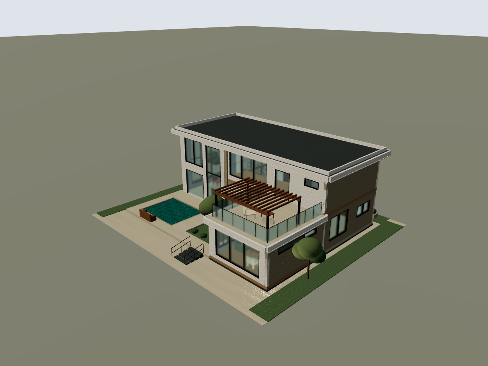
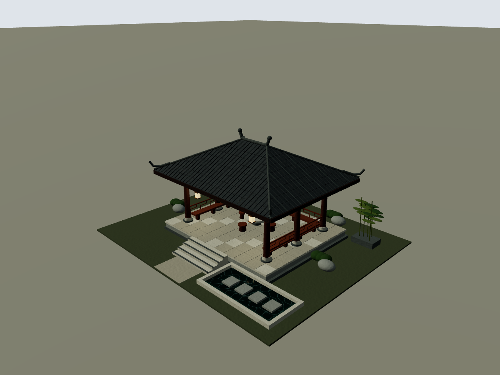
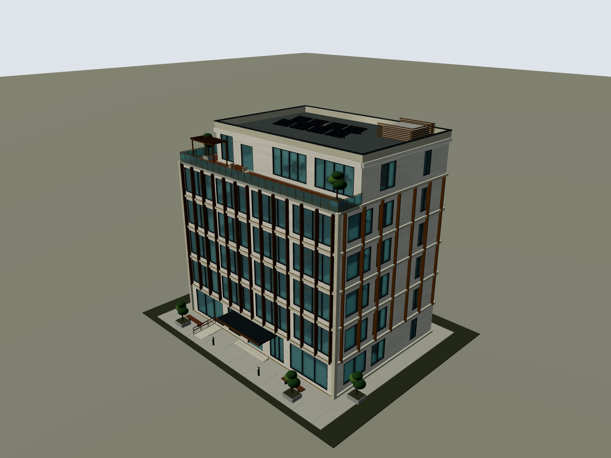

# 凉亭、写字楼与汀院的同条件查看

本次继续创建凉亭与写字楼。原汀院文件保持不变，另用当前项目重新出图，保存在 `凉亭写字楼同条件参考`，保留先前两栋别墅使用的历史渲染。

本次三者的真实渲染均为 1280×960、同一 Chromium、相同灯光/曝光与相机规则；源码摘要 `8beb450b713a720d867b4b20083b6c07529f18fd99564fdaef8cb14b1c8cc9ea`，上下文摘要 `8dc580390192171269aa754fbac2924a52d11d49e9d290fe47b1c2fcc577e5cf`。不同体量按同一规则自动取景，不假称三种建筑有相同绝对相机位置。

| 方面 | 汀院参考 | 听雨水榭 | 云序中心 |
|---|---|---|---|
| 体量 | 两层住宅与露台 | 六柱开敞凉亭，台基与浅池 | 六层写字楼，顶层双向退台 |
| 表面层次 | 石墙、通高玻璃、格棚 | 瓦垄/瓦缝/脊饰、木柱、斗拱、檩条、石铺地 | 石边框、竖向遮阳片、玻璃分格、雨棚、露台木平台 |
| 内部表达 | 住宅家具与楼梯 | 三面回纹坐凳、茶席和悬灯 | 接待、工位、会议、茶水、连续两跑梯和电梯井 |
| 屋面 | 平顶与压顶 | 四坡实体与檐下椽木 | 平顶女儿墙、设备屏风和倾斜光伏板 |
| 可核对证据 | 本次重渲染四视 | 外观四视与去屋面木构四视 | 外观四视与三个层次剖切各四视 |
| 引擎编译/重建错误 | 0 / 0 | 0 / 0 | 0 / 0 |

作者查看实际图后的判断是：两栋都达到本次类型需要的构造与材质细化深度；凉亭以木构和瓦作为重点，写字楼以立面遮阳与退台、室内交通为重点。最终审美仍请直接查看实图；构件数量或校验通过不能证明必然比另一种建筑更好看。

凉亭后端有 1 项承托识别局限，已保留原始报告与实际坡面接触复核；写字楼后端完整校验错误/警告均 0。两者具体边界见各自 README，不把图片细化深度等同于工程施工验收。
