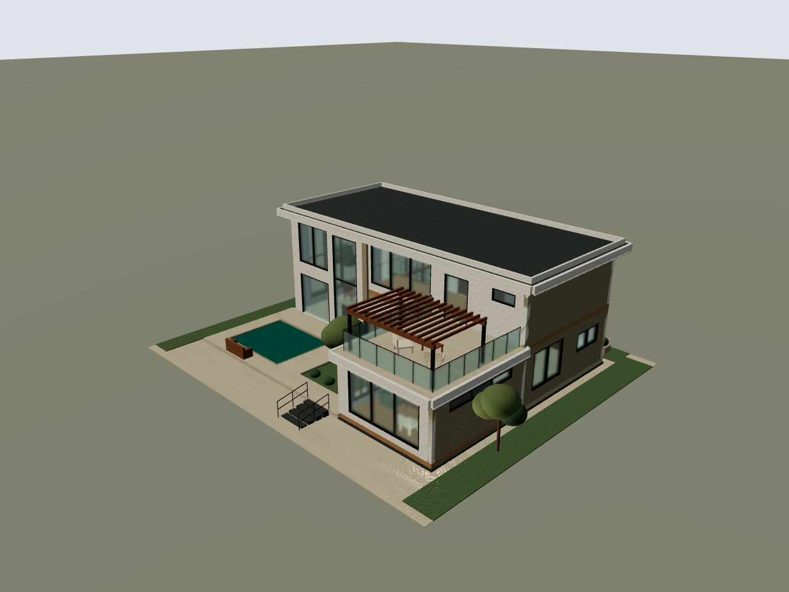
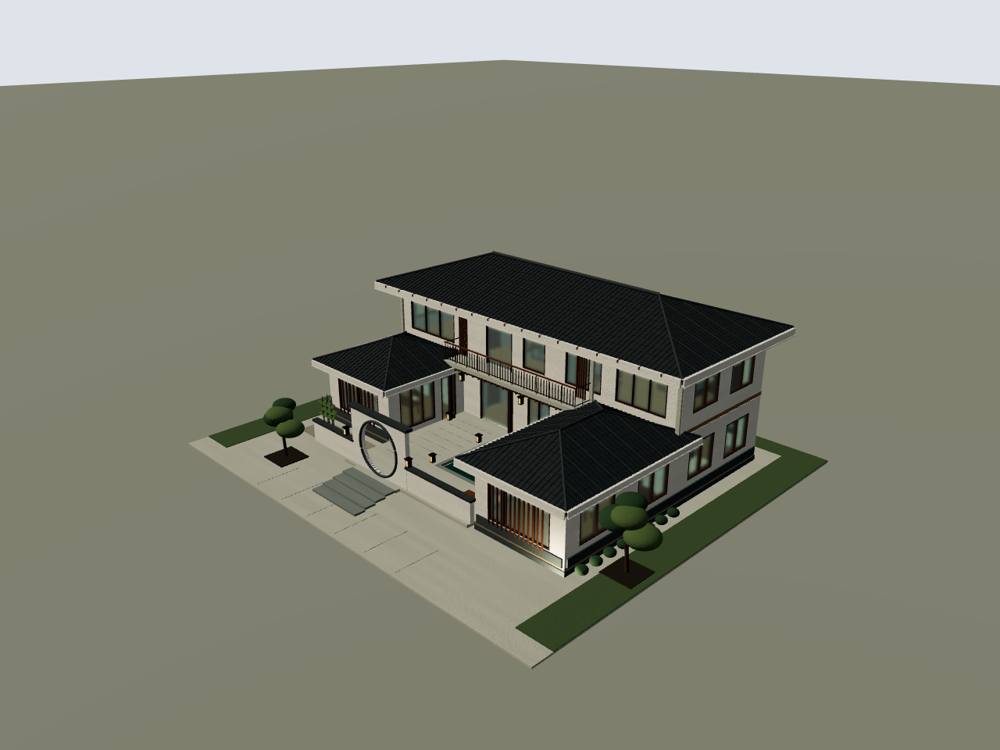
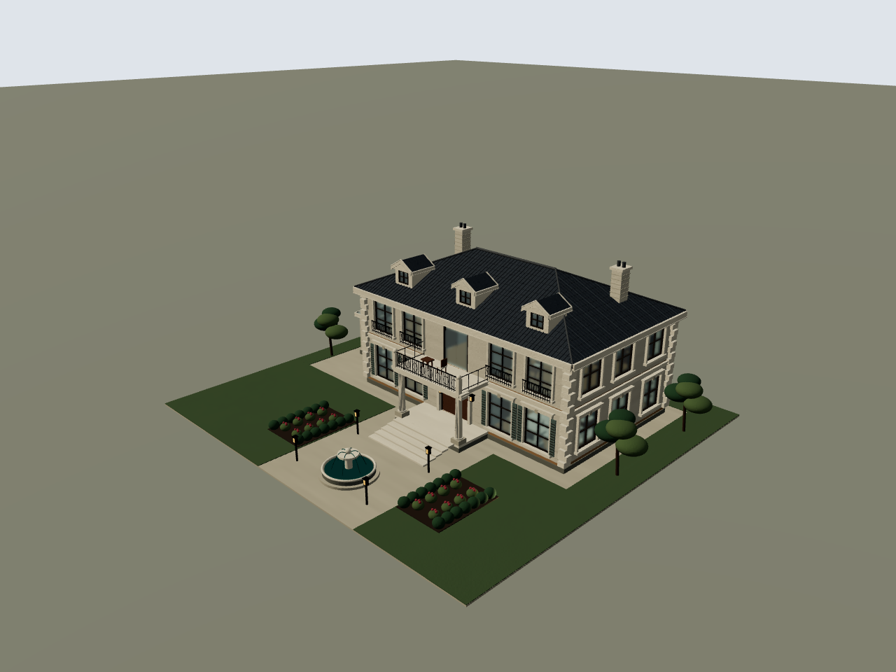

# 与汀院的同条件实图对照

参考原文件：`docs/10月20日优化/汀院别墅-Codex.wild`，保持原样。本次用当前项目原始 `render-baseline.mjs` 重新出四视图，并对两栋新建筑使用相同入口。

三者的 `sourceDigest`、`contextSha256`、浏览器版本、相机规则、1280×960 出图尺寸、灯光、曝光全部一致。没有使用 AI 效果图、外部建模渲染或后期亮度处理替换 WILD 的实际画面。

| 检查项 | 汀院 | 听澜合院 | 玫庭庄园 |
| --- | --- | --- | --- |
| 体量与外部空间 | 两层主楼、单层翼、池院与露台 | 两层主楼、高低双翼、露天院落与月洞门 | 两层主楼、柱廊露台、花房与轴线前庭 |
| 屋面表达 | 平屋面与压顶 | 四坡实体、坡向瓦垄、横缝、脊与檐下木构 | 陡四坡、瓦缝、老虎窗、双烟囱 |
| 立面表达 | 石材、通高玻璃、木格棚 | 勒脚、木窗与格栅、露廊细杆 | 石窗套、百叶、角石、腰线、齿饰、铁艺 |
| 室内 | 参考本身有家具和楼梯 | 起居、餐厨、茶室、书斋、卧室、浴室、梯井 | 起居、餐厨、书房、卧室、浴室、梯井 |
| 景观 | 池、草地、树 | 月洞门、池、景石、竹、修剪树与庭灯 | 喷泉水弧、玫瑰花坛、树与庭灯 |
| 当前真实渲染 | 编译/重建错误 0 | 编译/重建错误 0 | 编译/重建错误 0 |

以上是实际要素的对照，不用元素或网格数量计算审美分数。作者的视觉判断是：两栋在各自风格中的细部层次达到参考的细化深度，并有更明确的中式/法式特征；风格偏好与最终审美验收由用户看图判断。

## 实际透视图

### 参考：汀院

### 听澜合院

### 玫庭庄园

