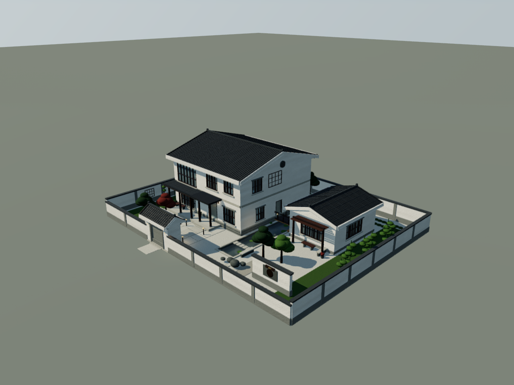
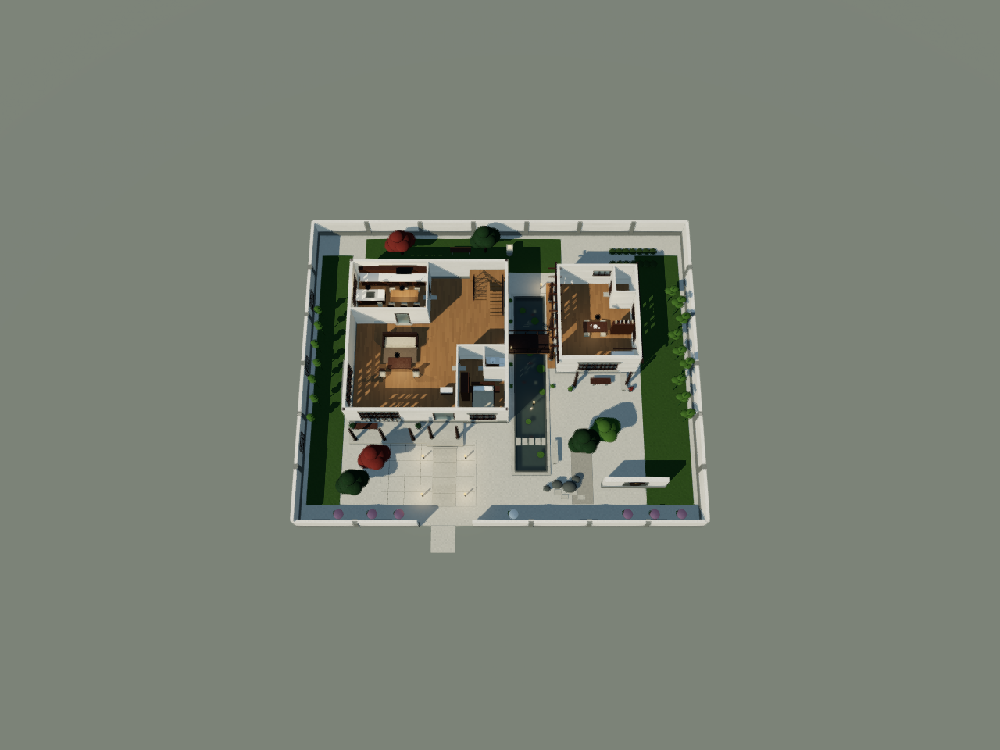
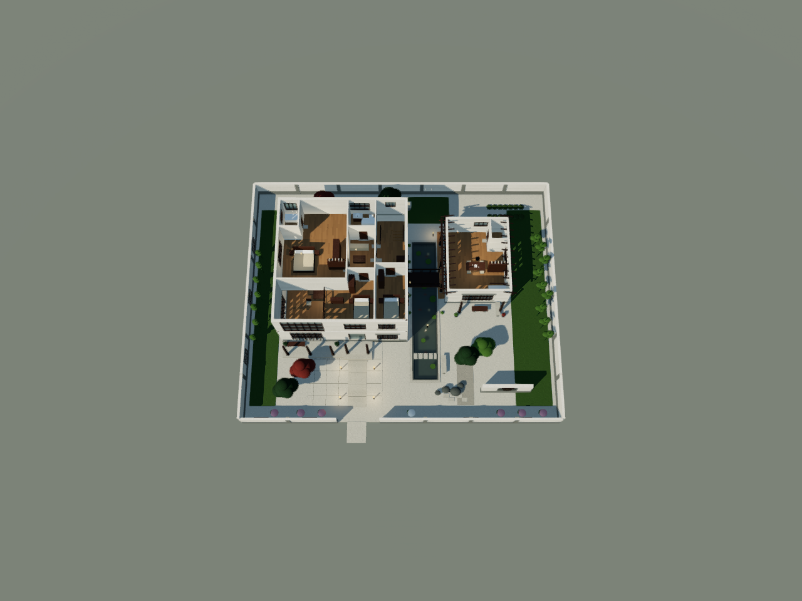

# 砚溪别院 · 新中式别墅

**分类：** 16-原创设计-新中式别墅  
**建筑类型：** 别墅/住宅  
**风格：** 新中式  
**空间原型：** 东宅西亭 · 南北长水院 · 木廊桥  
**设计方式：** 原创设计，不是图片复建

## 方案摘要

场地 30×24 m，南侧为到达面。东侧是两层主宅，西侧是单层茶室，中间留出从门屋一直延伸到前院的长水院；一座木廊桥在中部横跨，连接主宅与茶室。南侧门屋、照壁、跨水汀步和主宅三柱檐廊共同组成“门—院—水—桥—宅”的进入序列。

主宅首层为门厅、双高起居、餐厨、客卧套房与西北角楼梯厅；二层为三间卧室、家庭厅、公卫、主卧套房、双高挑空和楼梯井。茶室南侧增加两柱木格棚，东侧保留面向水院的檐廊。

## 交付入口

| 内容 | 文件 |
| --- | --- |
| 正式 WILD | [砚溪别院.wild](砚溪别院.wild) |
| 建筑分类 | [分类信息.json](分类信息.json)、[分类说明.md](分类说明.md) |
| 需求与设计 | [设计输入.json](01-需求与设计/设计输入.json)、[设计说明.md](01-需求与设计/设计说明.md) |
| 作者脚本 | [生成本建筑.py](02-生成脚本/生成本建筑.py) |
| 过程记录 | [生成过程.md](03-过程记录/生成过程.md)、[命令记录.json](03-过程记录/命令记录.json)、[构件统计.json](03-过程记录/构件统计.json)、[构件分层.json](03-过程记录/构件分层.json) |
| 校验 | [静态检查.json](04-校验/静态检查.json)、[Core 重建日志](04-校验/Core重建.log)、[项目流水线.json](04-校验/项目流水线.json)、[校验说明.md](04-校验/校验说明.md) |
| 效果图 | [白天正面](05-效果图/白天/front.png)、[侧面](05-效果图/白天/side.png)、[俯视](05-效果图/白天/top.png)、[透视](05-效果图/白天/perspective.png) |
| 黄昏 | [黄昏透视](05-效果图/黄昏/perspective.png)、[黄昏正面](05-效果图/黄昏/front.png) |
| 剖切 | [一层俯视](06-剖切查看/一层/效果图/top.png)、[二层俯视](06-剖切查看/二层/效果图/top.png)、[一层来源](06-剖切查看/一层来源.json)、[二层来源](06-剖切查看/二层来源.json)、[剖切脚本](06-剖切查看/制作本建筑剖切.py) |

## 最终指标

| 指标 | 结果 |
| --- | --- |
| 正式 WILD 字节数 | 225,507 bytes |
| SHA-256 | `0f31f0d4342167c7fbb91a54f1f4fee341641a897e6ba8b9d8d4925cbd36c97b` |
| 基础构件 | 1,397 |
| 组合构件 | 40 |
| 材质 | 37 |
| Core 重建网格 | 1,716 |
| 静态检查 | 0 错误 / 0 警告 |
| 项目校验流水线 | 0 Schema 错误 / 0 错误步骤 / 0 警告步骤 |
| 真实出图 | 白天 4 视图、黄昏 4 视图，均为 0 编译/重建错误、0 未映射材质 |
| 剖切 | 一层删除 698 个遮挡件、保留 716 构件/23 组件；二层删除 510 个、保留 887/40；两层静态与 Core 均 0 错误 |

## 验证口径

- 静态检查覆盖原始 JSON/Schema、ID、直接材质、宿主引用、直墙开口范围、墙尺寸与显式楼梯尺寸链。
- Core 重建覆盖真实解析、组件编译、网格重建、有限包围盒与网格数值。
- 项目校验流水线覆盖结构、必填字段、引用、开口、墙连接、楼梯、屋顶覆盖、碰撞、模型质量等步骤，`auto_fix=False`。
- 真实 Chromium 四视图共享编辑器的展示光照、曝光、阴影、局部灯与水面反射；出图后已实际查看白天、黄昏和两层剖切俯视。
- 剖切副本只删除遮挡构件，源文件与保留构件的坐标不变；剖切来源 JSON 记录了源 hash、副本 hash、删除 ID 与分层。

## 保留问题与边界

- 本稿不声称结构承载、消防、节能、无障碍或法规合规；家具可达性只做设计层面的通道保留，没有完整碰撞/导航认证。
- 前端交互、编辑器内拖拽与用户界面测试由用户执行；本轮只做 Core、项目校验与真实 WebGL 出图。
- 剖切副本用于查看室内关系，不替代正式 WILD；其缺屋面/缺上层板是删除遮挡的结果，不改写为正式建筑缺陷。
- 效果是审美判断，实图见上；零错误只证明对应自动检查，不证明施工或完整使用体验。
