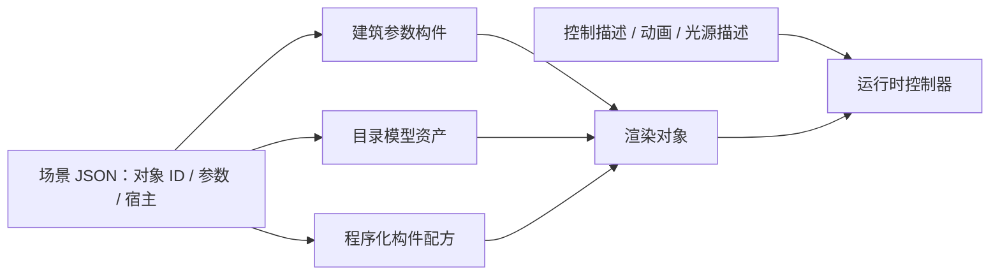

# editor 的丰富构件机制与 WILD 本次优化

核对日期：2026-10-23。依据本地 editor 与 WildAgent 当前源码；关系优化修改前端、Core 和规则，未修改后端或运行真实模型生成。后续路线按用户补充约束修订：以极小WILD文件表达精细建筑，不引入GLB/GLTF模型资产。本文区分已实现能力与后续参数化方案。

## 1. editor 的语言不只是 JSON 加一个 GLB 地址

JSON负责场景中对象的身份、参数、放置、宿主、材质覆盖和控制描述，几何可以来自不同通路。源码中至少有以下几种：

| 通路 | JSON描述什么 | 形状和动态来自哪里 |
| --- | --- | --- |
| 建筑参数构件 | 墙、板、屋顶、开口等节点及尺寸关系 | 对应构件实现根据参数建立几何 |
| 目录模型item | asset.src、尺寸、模型校正变换、依附方式、interactive | GLB/GLTF模型、模型里的动画片段，以及应用自己的控制与照明运行时 |
| 声明式程序构件 | parts、shapes、材质槽、连接/运动、安装信息 | 程序化几何和运动控制器；可以直接由JSON配方描述 |
| 脚本创作资产 | source中的脚本/参数/产物信息，asset中的编译结果 | 编译后的GLB、动画和材质等；保留创作源供后续修改 |

因此，不能把截图中的丰富度全部归因于“JSON更复杂”。它还依赖资产内容、构件代码、编辑能力和运行时。GLB可以存放几何、材质、节点和动画；应用内“哪个开关控制什么”“模型装在哪一面墙”仍要另外表达。[glTF官方规范](https://registry.khronos.org/glTF/specs/2.0/glTF-2.0.html)



### 会动的风扇

目录模型可以在GLB内包含转子动画，item的interactive描述开关及动画片段名。renderer使用useAnimations读取片段，并根据开关切换、缓启停。动画播放仍由每帧更新推进；Three.js的AnimationMixer承担对象动画播放。[AnimationMixer说明](https://threejs.org/docs/pages/AnimationMixer.html)

另外，editor现有ceiling_fan程序构件例子直接声明转子部件的运动：

```json
{"kind":"spin","pivot":[0,2.1,0],"axis":"y","radiansPerSecond":6}
```

这是该例子某个part的motion片段，不是WILD现有语法。静止的吊杆与旋转的叶片属于不同运动组，因此可以只转叶片。它并不要求所有风扇都先下载一个GLB。

### 不同样式的灯

灯罩、吊线、灯泡的外形可以来自模型或程序几何；interactive.effects里的light描述负责实际光源。亮面材质与真实照明是两件事。模型资产可以共用一套调光与光源预算，换灯罩外形不需要重写整个照明系统。

### 对应源码

- editor的BaseNode定义ID、parentId、可见性和元数据；ItemNode增加asset、source、安装与交互描述：`E:/AgentProject/editor/packages/core/src/schema/base.ts`、`schema/nodes/item.ts`。
- 模型加载、材质与动画接入：`packages/nodes/src/item/model-loader.ts`、`renderer.tsx`。
- 风扇声明式例子：`packages/core/src/procedural-items/__fixtures__/ceiling_fan.json`；运动实现位于同目录的motion-controller等模块。
- 程序构件控制项：`packages/viewer/src/systems/interactive/procedural-controls.ts`。

这些是本地源码依据，未对editor整套应用另做运行验收，也没有把React组件直接搬入Vue项目。

## 2. 四条建议的实施结果

### 统一关系处理：已实现

[共享关系契约](../../wild-core/src/relationships.ts)集中识别parentWall、parentFloor、parentRoof、attachment.parent和onSurface.parent，并构建宿主与依附者索引。删除、移动、校验、缓存和场景树复用这些关系。

当前编辑索引覆盖源elements、components和placements；模板内部及实例展开后的跨作用域宿主还没有纳入统一编辑，不能据此宣称所有实例关系均已解决。

- 删除沿关系递归清理依附对象，包括排布链，再按原协议清理物理约束和编辑分组。
- 缺失宿主、错误宿主类型和循环依附会进入前端校验；不自动删除或改接用户构件。
- 场景树按几何宿主展示和收缩，不新增持久化parentId/children，也不把墙强制归入单一房间。
- 场景树对异常循环保留可选择入口；完整依赖仍由关系索引表示，展示树不等于所有权模型。

编译缓存保留算法真正读取的额外上下文。雨棚、阳台和部分檐口会根据整栋墙体范围判断外侧；现在这项读取在注册表中显式声明。不能为了“只依赖宿主”而漏掉它，否则改变另一面墙仍可能复用错误结果。

### 坐标和移动：已实现有依据的范围

[附墙坐标入口](../../wild-core/src/compiler/components/attachedToWall.ts)由组合构件编译与拖动复用；from仍为[沿墙距离,世界高度,法向偏移]，没有改成全局部坐标。组合构件的曲线仍沿用原采样路径实现，没有在本次改成另一套精确曲线规范。

| 附件 | 单独拖动 | 宿主与附件同时移动 |
| --- | --- | --- |
| 附墙门窗/雨棚等 | 世界位移投影到墙路径坐标 | 水平沿墙和法向参数不变，世界高度只加一次 |
| 楼板依附栏杆/坡道 | 更新楼板局部参数 | 局部参数不再加一次位移，由楼板带动 |
| 屋面依附烟囱/檐口 | 通过屋面正反转换处理坡面高度 | 保持等价局部参数，由屋顶带动 |
| 致密砖的attachment引用 | 更新自身世界坐标 | 通过依附闭包跟随；不宣称mapping已实现真实贴面变形 |

拖动预览和提交复用同一组受影响源ID，避免局部参数没有变化的附件在预览中留在原处。位移规划不修改输入，整个动作作为一次Patch进入撤销历史。

历史parentRoof世界坐标兼容分支继续保留。用户执行移动时，按现有编译器对旧值的解释转换为等价局部值，并包含在同一次可撤销修改中；不在加载文件时偷偷重解释数字。

### 源构件与生成几何身份：保留既有机制，补齐检查

原编译器已经返回双向ID映射，原视口也会将生成零件拾取回源构件。本次没有重写这部分。新增了源对象删除后的失效选择清理，并验证：点击玻璃选中源窗；改窗宽后源ID及选择保持；一次撤销恢复宽度；宿主级删除与撤销恢复整组内容。编译失败的源构件仍保留在文档和场景树中供修正。

### 构件能力声明：小范围落地

[构件注册表](../../wild-core/src/compiler/componentRegistry.ts)增加现有内置构件的移动方式、宿主字段、可编辑参数和额外上下文依赖。移动、属性面板以及缓存已消费这些信息；getComponentCapabilities也可返回描述数据。

这不是完整插件平台，也没有改后端Agent工具、提示词或检索。声明只覆盖当前实现需要的信息，不能据此认为任何外部构件已经获得自动吸附、碰撞或导出能力。

## 3. 明确没有硬实现的边界

1. **带附件楼板/屋顶的整体旋转**：现在限制入口。现有楼板/屋面没有统一姿态与附件旋转协议，单独交换宽深会造成附件位置或高度错误。直线墙与附墙构件的既有旋转仍可用。
2. **原生opening在曲墙上的直接拖动**：现在给出明确提示并恢复预览。原生曲线开口与组合构件的定位实现尚未完全统一，不能套直墙投影或猜测另一套弧长。可以编辑沿墙参数或移动宿主墙。
3. **多边形楼板的parentFloor依附**：楼板自身能表达多边形和孔洞，但栏杆/坡道的附板编译当前只支持矩形和圆形。没有强行用包围盒冒充真实多边形/孔洞范围，仍由现有编译器明确报告不支持。
4. **模型资产与运动**：按项目定位，不采用GLB/GLTF模型资产路线；风扇的声明式运动尚未实现。WILD的assets当前是PBR纹理集，并不是通用模型资产表；不能直接填写glb地址或spin字段就宣称支持。
5. **楼层/房间组织与复制楼层**：没有新增组织字段或复制命令。几何宿主与空间成员关系分开；现有editor.groups仍按原语义保留。

## 4. WILD 下一步怎样用小文件表达丰富构件

项目的核心约束是小文件与精细建筑同时成立。后续以参数化几何、可复用程序装配和声明式行为增强表达力，不引入GLB/GLTF模型，也不把顶点/索引数组或模型base64塞进JSON来规避这一约束。小文件来自以少量设计信息重建丰富几何；程序实现和网格计算由引擎承担。

优先顺序：

| 路线 | 精细度与体积如何兼顾 | 当前边界 |
| --- | --- | --- |
| 增强参数化几何 | 用尺寸、轮廓、路径、分缝和构造参数生成窗套、栏杆、檐口、家具、灯罩等，避免逐个保存生成零件 | 复用现有原语/扫掠/组合构件；新增通用几何操作须单独实现验证 |
| 可复用装配与变体 | 用零件、材料槽、局部变换和少量参数表达构件族，保留AI在比例、组合、材料和布置上的设计空间 | 概念路线，不新增任意脚本或未经实现的配方字段，也不为每种外观新建一种类型 |
| 紧凑定义与实例 | 同一窗组、书架或灯具定义一次，实例只记录放置和必要覆盖，降低重复文本 | 项目已有模板/实例机制；跨作用域宿主、源ID映射与实例编辑尚未统一，当前主语言仍要求基础数组展开，不直接开放新repeat语法 |
| 声明式运动 | 风扇由叶片数量/轮廓等几何参数和转子枢轴、轴向、速度重建，只记录运动规则，不保存逐帧网格 | 未来能力；现有门窗/灯交互保持原协议，不能把editor的spin片段写入当前WILD |
| 材质与渲染细化 | 用程序纹理、米制UV、法线/粗糙度、真实光源和适当后期补充表面与光感，减少无价值小零件 | 小文件不代表低渲染成本；程序材质与灯预算仍需测量，光影不能替代真实洞口和必要构造 |

原GLB接入建议由本节替代。editor可借鉴的部分是参数表达、零件装配、控制项和运行时分工；前文对其模型加载的说明仅用于解释editor现状。

验收先选一台程序化风扇和两种参数可变灯具，比较同等可见细节下的UTF-8原始文件字节数、加载/编译耗时、三角面与绘制调用、运行帧率，再检查移动、删除、撤销、控制和保存重开。压缩后字节数可另报，不能把隐藏下载或外置大资源排除后宣称文件很小，也不设未经测量的体积或帧率保证。引擎新增算法需明确版本语义，不能通过修改默认值使旧文件换一种外观。

本节只修正优化方向，没有新增Schema字段或运行时功能；新能力在Schema、编译、渲染、编辑闭环完成后再进入主语言。

## 5. 本次验证

- [关系回归](../../deliveries/component-relations/关系回归.json)：墙/楼板/屋顶的移动、多选、删除；坡面世界位移；旧屋面坐标；正负圆弧投影；排布链；缺失/错误/循环宿主；缓存命中与失效。
- [浏览器验证](../../deliveries/component-relations/浏览器验证.json)：实际玻璃拾取、属性编辑、稳定ID、撤销、可收缩宿主树、删除清理和恢复；运行时/着色器错误为0。
- 原有十二例的编译/重建回归、前端类型检查和构建；另复核既有视口交互与水面/灯光渲染回归。检查与真实浏览器效果分别确认，没有运行后端生成链，也不宣称所有模型/场景均已通过。

测试入口：wild-web/scripts/relations-regression.mjs、relations-browser-smoke.mjs。后者使用已有的临时存储服务与独立Chromium，不连接用户浏览器或调用模型服务。
